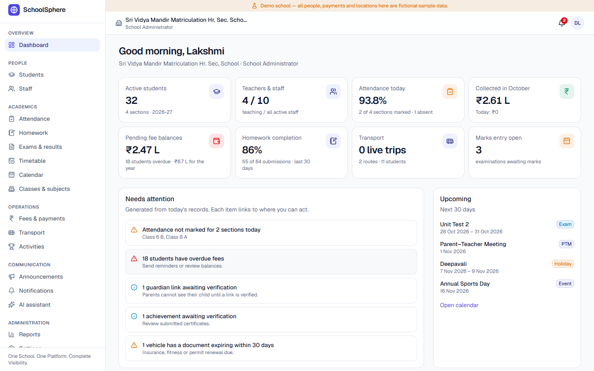
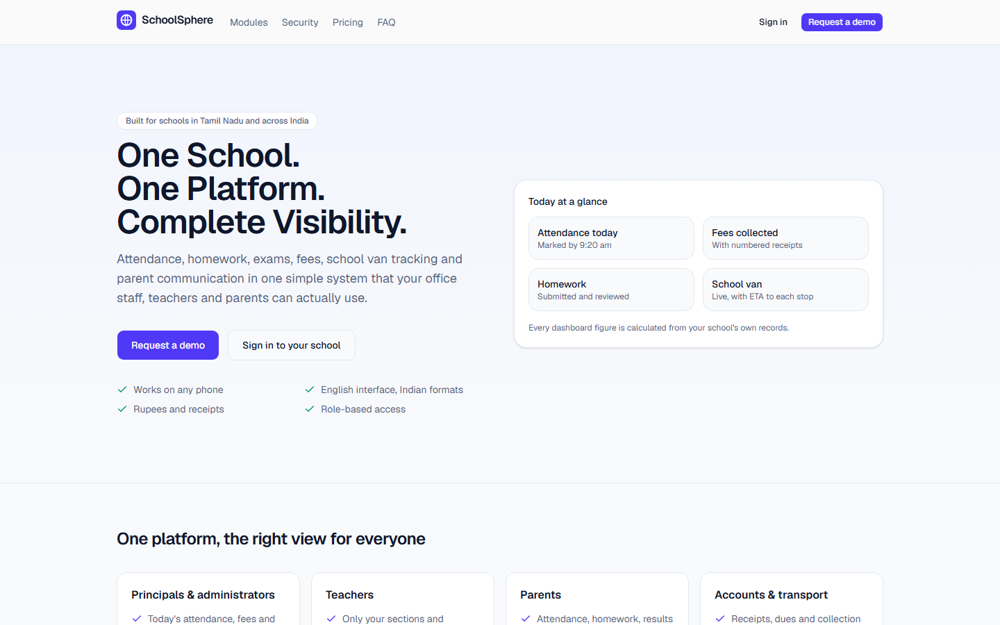
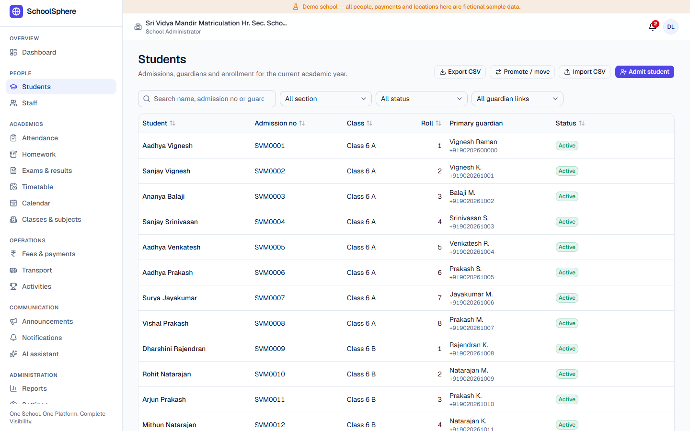
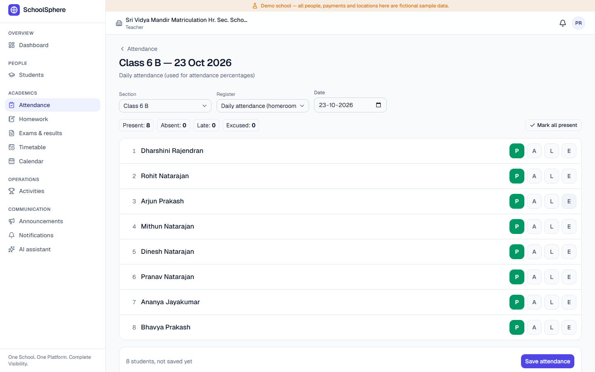
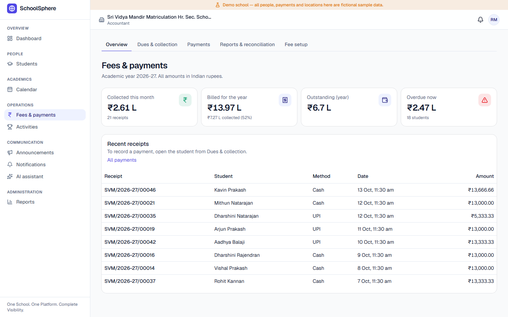
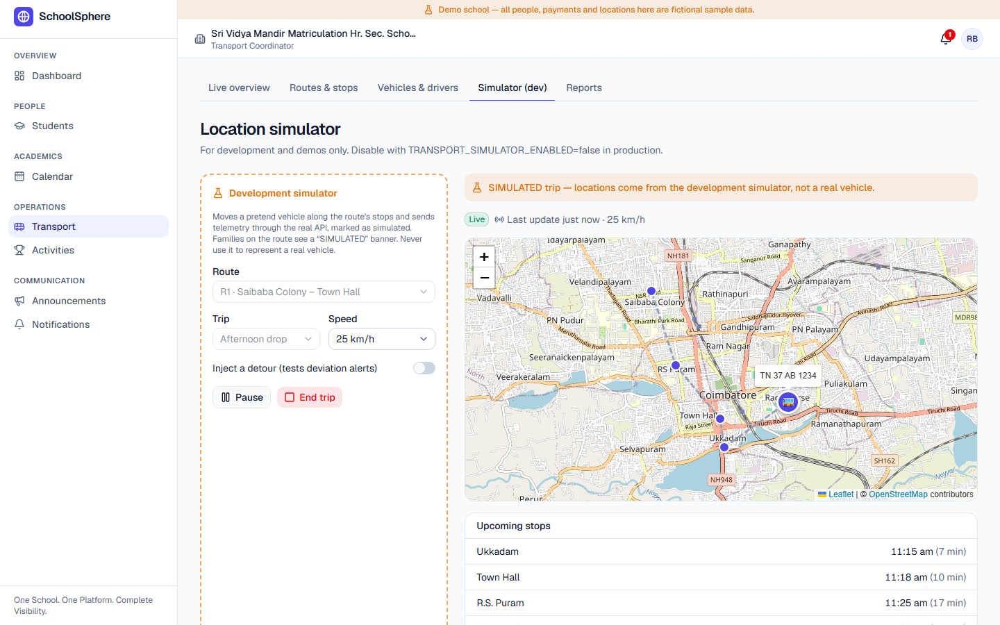
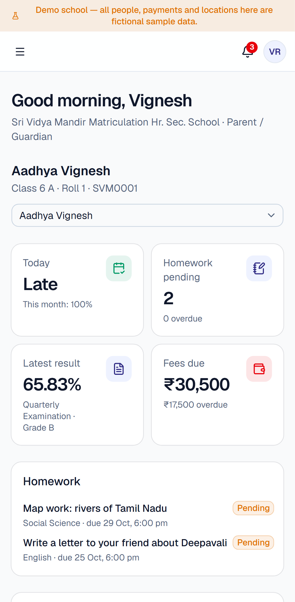

# SchoolSphere

**One School. One Platform. Complete Visibility.**

SchoolSphere is a multi-tenant school operating system for Indian schools (starting with Tamil Nadu). It covers admissions, attendance, homework, examinations and report cards, fees and receipts, school van tracking, extracurricular activities, announcements and notifications, and an AI assistant. It has separate experiences for administrators, accountants, teachers, parents, students, transport coordinators, bus drivers and platform operators.

> Status: see [PROJECT_STATUS.md](PROJECT_STATUS.md) for what is done, verified and still open.



## Features

| Module | What it does |
|---|---|
| **Administration** | Admissions, student profiles, guardians with verification, staff, classes and sections, subjects, timetable, calendar, CSV import/export, year-end promotion |
| **Attendance** | Daily register per section, late/half-day/leave, corrections with a reason and history, monthly reports, parent calendar view, unmarked-section alerts |
| **Homework** | Assignments with attachments, online submission, grading and feedback, return for changes, extensions, reminders |
| **Exams & report cards** | Exam schedules, marks entry per subject, grade scales, publication workflow, correction audit, printable report cards, class statistics |
| **Fees & payments** | Fee structures and installments, concessions, counter payments with numbered receipts, dues and reminders, reconciliation, online payment via Razorpay |
| **School van tracking** | Routes and stops on a map, driver phone GPS or hardware trackers, live map with ETA for parents, delay and route-deviation alerts, pickup/drop events |
| **Activities** | Clubs and sports, registration, session attendance, achievements with certificate verification, student development portfolio |
| **Communication** | Announcements by audience, in-app notifications with per-type preferences, email/WhatsApp/push channels |
| **AI assistant** | Worksheets, circular drafts, class trends, weekly progress notes and report explanations, with privacy safeguards and human approval |
| **Dashboards** | Separate home screens for principal/admin, accountant, teacher, parent, student, transport coordinator and driver, plus a platform operator console |

## Screenshots

| Landing page | Students |
|---|---|
|  |  |
| **Teacher attendance** | **Fees & payments** |
|  |  |
| **Live van tracking (simulator)** | **Parent dashboard on a phone** |
|  |  |

All names, payments and locations in the screenshots are fictional demo data.

---

## Contents
1. [Quick start (local, no accounts needed)](#quick-start)
2. [Demo accounts](#demo-accounts)
3. [Architecture](#architecture)
4. [Roles and permissions](#roles-and-permissions)
5. [Configuration](#configuration)
6. [Database and migrations](#database-and-migrations)
7. [Production setup with Supabase](#production-setup-with-supabase)
8. [Payments (Razorpay)](#payments-razorpay)
9. [Transport tracking and GPS devices](#transport-tracking-and-gps-devices)
10. [AI assistant](#ai-assistant)
11. [Notifications](#notifications)
12. [Testing](#testing)
13. [Deployment](#deployment)
14. [Security notes](#security-notes)
15. [Backup and recovery](#backup-and-recovery)
16. [Project structure](#project-structure)
17. [Known limitations](#known-limitations)
18. [Contributing](#contributing)
19. [License](#license)

---

## Quick start

Requirements: Node.js 20.9+ (22 recommended) and npm. No Docker, no database server and no cloud account are needed for local development.

```bash
npm install
cp .env.example .env.local      # then set AUTH_SECRET (32+ random characters) and DEMO_USER_PASSWORD
npm run db:reset                # creates .data/pglite, applies migrations, loads two demo schools
npm run dev                     # http://localhost:3000
```

Open <http://localhost:3000/login>. With `DEMO_MODE=true`, the login page lists every demo account and you can sign in with one click. You can also sign in with an email and the `DEMO_USER_PASSWORD` you set.

> The local database runs **inside the Next.js process** (PGlite: PostgreSQL compiled to WebAssembly). Stop `npm run dev` before running `db:migrate`, `db:seed` or `db:reset`, because two processes must not open the same data directory.

Useful scripts:

| Script | What it does |
|---|---|
| `npm run dev` | Development server |
| `npm run build` / `npm start` | Production build and server |
| `npm run lint` / `npm run typecheck` | ESLint / TypeScript |
| `npm test` | Unit and integration tests (Vitest, real SQL with RLS on PGlite) |
| `npm run test:e2e` | Playwright journeys (needs a running server with the demo seed) |
| `npm run db:migrate` | Apply pending migrations (PGlite or `DATABASE_URL`) |
| `npm run db:seed` | Load the two demo schools (refuses in production) |
| `npm run db:reset` | PGlite only: delete, migrate and seed |

## Demo accounts

`npm run db:seed` creates two independent schools. All data is fictional and every account uses the reserved `.test` email domain.

| School | Location | Board |
|---|---|---|
| Sri Vidya Mandir Matriculation Hr. Sec. School (`svm`) | Coimbatore | Matriculation |
| Green Valley Public School (`gvp`) | Madurai | CBSE |

Accounts follow the pattern `<role>.<school>@schoolsphere.test`, for example `admin.svm@…`, `accounts.svm@…`, `teacher1.svm@…`, `parent.svm@…`, `student.svm@…`, `transport.svm@…` and `driver1.svm@…`, plus `platform@schoolsphere.test` for the operator console. Every account uses the password set in `DEMO_USER_PASSWORD` when you seed.

Worth trying:
- `parent.svm`: two children (siblings in Class 6 A and 8 A), with a sibling fee concession, a bus route and a pending achievement.
- `parent2.svm`: the guardian link is **not verified**, so the parent sees no child until the school verifies it.
- Two sections in School A have no attendance marked "today", so the admin dashboard shows an alert.

## Architecture

| Layer | Choice |
|---|---|
| UI | Next.js 16 (App Router), React 19, TypeScript, Tailwind CSS v4, shadcn/ui (Radix), Lucide, React Hook Form + Zod, Recharts, Leaflet + OpenStreetMap |
| Server | Server Components and Server Actions; route handlers for exports, files, telemetry and webhooks |
| Data | PostgreSQL with Row Level Security. In production this is Supabase Postgres; for local development and tests it is PGlite |
| Auth | Supabase Auth in production; a self-contained local provider for development and tests |
| Storage | Supabase Storage (private bucket) in production; a local folder in development |

Key decisions:

- **RLS for every query.** Each request runs in a transaction that sets the caller's JWT claims and `SET LOCAL ROLE authenticated` (see `src/lib/db/index.ts`, `withUser`). The policies in `supabase/migrations/*_rls.sql` therefore apply to everything the app reads and writes, exactly as they would to a Supabase client. `withService` (owner privileges) is used only for trusted work: webhooks, device telemetry, invitation acceptance, notification fan-out, onboarding and seeding.
- **Tenant isolation in two layers.** Every tenant table carries `school_id` with a `unique (school_id, id)` key. Child rows reference parents through composite foreign keys `(school_id, parent_id)`, so cross-school links are impossible even in the trusted context.
- **One SQL dialect everywhere.** The same migrations run on Supabase, plain PostgreSQL and PGlite. `db/local/00_supabase_compat.sql` recreates the small part of Supabase's `auth` schema that the migrations use, and it is applied only where that schema does not exist.
- **Money in paise.** All amounts are `bigint` paise. Percentage discounts are rounded half-up to the paisa when granted and then stored as amounts. The payment ledger is immutable apart from voiding, and deferred constraint triggers reject over-allocation and unbalanced payments at commit (`supabase/migrations/*_fees.sql`, `src/lib/payments/ledger.ts`).
- **Append-only audit log.** Triggers record changes to sensitive tables, including the acting user and an optional reason. Updates and deletes on `audit_logs` are rejected for everyone, including the service role.
- **Request-time rendering.** `cacheComponents` is disabled and authenticated segments are `force-dynamic`, because every app page is per-user and authorization-sensitive. Only the marketing page is static.

## Roles and permissions

The matrix lives in `src/lib/auth/permissions.ts` and drives server actions and navigation. RLS enforces the same boundaries independently in the database.

| Capability | Admin | Accountant | Teacher | Parent | Student | Transport coord. | Driver |
|---|:-:|:-:|:-:|:-:|:-:|:-:|:-:|
| Students, guardians, staff, classes | manage | view | own sections | own children (verified) | self | transport students | — |
| Attendance | all | — | mark own sections | view child | view self | — | — |
| Homework | all | — | own sections & subjects | view child | submit | — | — |
| Exams & marks | manage, publish, correct | — | enter own subjects until published | published only | published only | — | — |
| Fees & payments | manage | manage, record | — | view, pay online | — | — | — |
| Transport | manage | — | — | child's live trip | — | manage, simulator | own route; pickup list via `get_trip_manifest()` |
| Activities & achievements | manage, verify | view | manage/verify own | register, submit | view | view | — |
| Announcements | all audiences | view | own sections | view | view | view | view |
| AI assistant | yes | reports | yes | — | — | — | — |
| Settings, users, audit log | yes | — | — | — | — | — | — |

The **platform super admin** (`/platform`) manages tenants and sees aggregate counts through `platform_school_metrics()`. It has no RLS access to children's records.

## Configuration

Every option is documented in [.env.example](.env.example). The values are validated at startup (`src/lib/env.ts`), so a misconfigured deployment fails loudly. Settings → Integrations inside the app shows what is and isn't connected.

## Database and migrations

Migrations live in `supabase/migrations/` and are applied in filename order:

| File | Contents |
|---|---|
| `…0100_foundation` | schools, profiles, memberships, invitations, audit log and triggers |
| `…0200_academics` | years, terms, classes, sections, subjects, staff, students, guardians, enrollments, timetable, calendar |
| `…0300_attendance_homework` | attendance, assignments, extensions, submissions, file metadata |
| `…0400_exams` | grade scales, examinations, subjects, marks, report-card remarks |
| `…0500_fees` | categories, structures, installments, student fee lines, payments ledger, gateway orders, webhook events |
| `…0600_transport` | vehicles, drivers, routes, stops, assignments, trips, devices, locations, pickup events, alerts |
| `…0700_activities_communication` | activities, enrollments, achievements, announcements, notifications, AI drafts |
| `…0800_rls` | helper functions, all RLS policies, grants, audit triggers, `get_trip_manifest` |
| `…0900_views` | `student_fee_balances` (security invoker) |
| `…1000_exam_statistics` | aggregate-only class averages for families |
| `…1100_platform` | aggregate tenant metrics for the operator |

- **Local:** `npm run db:migrate` (PGlite).
- **Plain PostgreSQL:** set `DB_DRIVER=postgres` and `DATABASE_URL`, then run `npm run db:migrate`. The compatibility layer is applied automatically when no `auth` schema exists.
- **Supabase:** see the next section.

## Production setup with Supabase

1. Create a Supabase project. Choose the Mumbai region (`ap-south-1`) for Indian schools.
2. Apply the migrations, using either
   - the Supabase CLI: `npx supabase link --project-ref <ref>` then `npx supabase db push`, or
   - `DB_DRIVER=postgres DATABASE_URL=<connection string> npm run db:migrate` (the runner detects Supabase's `auth` schema and skips the local compatibility file).
3. Create a **private** Storage bucket named `school-files` (or set `SUPABASE_STORAGE_BUCKET`). Downloads always go through `/api/files/[id]`, which checks access first.
4. In Authentication → URL configuration, add `<APP_URL>/auth/callback` as a redirect URL (used by password-reset emails).
5. Set environment variables: `AUTH_PROVIDER=supabase`, `NEXT_PUBLIC_SUPABASE_URL`, `NEXT_PUBLIC_SUPABASE_ANON_KEY`, `SUPABASE_SERVICE_ROLE_KEY`, `DB_DRIVER=postgres`, `DATABASE_URL`, `STORAGE_DRIVER=supabase`, `DEMO_MODE=false`, `TRANSPORT_SIMULATOR_ENABLED=false`, `PAYMENTS_SANDBOX_ENABLED=false`, and `APP_URL`.
6. Create the first platform administrator. Sign up the user in Supabase Auth, then run `insert into public.platform_admins (user_id) values ('<auth user id>');` in the SQL editor. From `/platform`, onboard schools and send each principal their invitation link.

> The Supabase code paths (auth provider, storage driver, `postgres` driver) are implemented. They are **not yet tested against a live Supabase project**, because none was available while building. Everything else was verified locally on PGlite (see Testing).

## Payments (Razorpay)

- Counter payments (cash, UPI reference, cheque, bank transfer) need no configuration and issue sequential receipts (`PREFIX/2026-27/00001`).
- For online payments set `PAYMENTS_PROVIDER=razorpay`, `RAZORPAY_KEY_ID`, `RAZORPAY_KEY_SECRET` and `RAZORPAY_WEBHOOK_SECRET`, and add a webhook in the Razorpay dashboard pointing to `<APP_URL>/api/payments/webhook/razorpay` with the events `payment.captured` and `payment.failed`.
- The flow is:
  1. The server creates the order.
  2. The browser opens Razorpay Checkout.
  3. The server verifies the `order_id|payment_id` HMAC signature, **or** receives the signed webhook.
  4. Only then is the payment recorded.

  Capture is idempotent on the provider payment ID, so a webhook arriving after the browser callback (or twice) changes nothing. Card details and UPI PINs never touch SchoolSphere.
- **Sandbox:** with `PAYMENTS_SANDBOX_ENABLED=true`, parents in **demo schools only** see a clearly labelled simulated checkout. Sandbox receipts are watermarked "SANDBOX" and stored with `mode = 'sandbox'`.

## Transport tracking and GPS devices

- **Driver phone:** the driver opens *My trips*, starts the trip and keeps the screen open. The browser shares GPS every ~10 seconds. This needs HTTPS (or localhost).
- **Hardware tracker:** register it in Transport → Vehicles & drivers to get a one-time token (only its hash is stored). The device then posts:

```bash
curl -X POST "$APP_URL/api/transport/telemetry" \
  -H "Authorization: Bearer <device token>" -H "Content-Type: application/json" \
  -d '{"latitude": 11.0168, "longitude": 76.9558, "speedKmh": 24, "recordedAt": "2026-10-22T02:01:00Z"}'
```

  Fixes are stored only while the device's vehicle is on a running trip. The API returns `202` otherwise.
- **Families** see the live position and an ETA only while a trip on their child's route is running, and never the history. **Drivers** get a minimal manifest (name, class, stop, guardian contact) through a security-definer function and have no access to student tables.
- **Alerts:** route deviation (>600 m from the planned path) and delays (≥10 minutes behind the stop schedule) notify transport staff. Delays also notify families waiting at later stops. Each alert is raised at most once per 15 minutes per trip.
- **ETA:** distance along the remaining stops × 1.3 road factor, at the recent average speed (or 18 km/h), plus one minute per stop. No estimate is shown when the last fix is more than 5 minutes old.
- **Simulator** (`TRANSPORT_SIMULATOR_ENABLED=true`): coordinators can run a simulated vehicle along a route. Simulated trips are flagged in the database, shown with a "SIMULATED" banner everywhere, and can never be mixed with real locations.
- **Live updates** use polling of `/api/transport/trips/[id]/live` every 3–5 seconds. That endpoint is the single source of truth, so Supabase Realtime can replace polling later without changing authorization.

## AI assistant

Set `AI_PROVIDER=anthropic` with `ANTHROPIC_API_KEY` (default model `claude-opus-5-5`, with server-side refusal fallback enabled), or `AI_PROVIDER=openai` with `OPENAI_API_KEY`.

It offers:
- worksheet and question generation
- circular drafting (handed to the announcement form for review)
- class-level trend summaries (aggregates only)
- weekly student progress notes
- report explanations
- "find information" questions, answered from the user's own RLS-scoped records

Safeguards:
- Student names are not sent. Student summaries use anonymised figures, and the name is re-inserted locally.
- Authorization is checked before any data is read.
- Prompts forbid psychological or medical labelling and invented facts.
- Every output is labelled as an AI suggestion and stored as a draft in `ai_generations`.
- AI-drafted report-card remarks stay invisible to families until a teacher approves them.
- Without a key, every tool falls back to a template built from school records.

## Notifications

In-app notifications always work. They cover attendance, homework, marks publication, fee receipts and reminders, announcements, events, transport pickup and drop-off and delays, and activities. Users choose channels per notification type.

Email (Resend), WhatsApp Business (Meta Cloud API, template `schoolsphere_update`) and Web Push are provider boundaries in `src/lib/notifications/channels.ts`. **Nothing is sent externally unless `NOTIFICATIONS_EXTERNAL_ENABLED=true` and the provider is configured.** Every attempt, including skipped ones, is logged in `notification_deliveries`.

## Testing

```bash
npm test                                   # 99 tests
E2E_BASE_URL=http://localhost:3000 npm run test:e2e
```

- **Unit:** money and rounding, installments and allocation, the attendance policy, grading and absent handling, ETA and geometry, input schemas, CSV formula-injection protection, upload validation and the permission matrix.
- **Integration (real SQL on PGlite, RLS enforced):** tenant isolation across two schools including direct ID lookups, parent/teacher/student/driver/platform scopes, the audit log's immutability, ledger immutability, over-allocation and unbalanced payments, idempotent counter payments, sandbox capture with duplicate confirmation, Razorpay signature and webhook verification, assignment submission rules, AI fallbacks, authorization and privacy, CSV import validation, and transport telemetry, visibility and alerts.
- **End-to-end (Playwright):**
  - landing page and demo request
  - redirect to sign-in
  - admission of a student with a guardian
  - teacher attendance
  - counter payment with a receipt
  - parent sandbox payment
  - cross-school access by URL, plus unauthenticated API calls
  - another family's receipt
  - transport simulator
  - mobile layout

  The e2e journeys create records; run `npm run db:reset` afterwards for pristine demo data.

## Deployment

- **Vercel or any Node host:** `npm run build && npm start`, with the production variables above. Use `DB_DRIVER=postgres`; PGlite is for development and single-machine demos.
- **Local demo of the production build:** `ALLOW_LOCAL_AUTH_IN_PRODUCTION=true npm start` (shows the demo banner; do not expose it publicly).
- Logs are structured JSON on stdout/stderr (`src/lib/logger.ts`).
- Security headers (`nosniff`, `frame-deny`, `referrer` and `permissions` policies) are set in `next.config.ts`.

Production checklist: `DEMO_MODE=false`, `TRANSPORT_SIMULATOR_ENABLED=false`, `PAYMENTS_SANDBOX_ENABLED=false`, a real `AUTH_PROVIDER=supabase`, HTTPS, a private storage bucket, the Razorpay webhook secret, and backups (below).

## Security notes

- Secrets are read only on the server (`src/lib/env.ts`). Only `NEXT_PUBLIC_*` values reach the browser, and the Supabase anon key is safe to expose because RLS protects every table.
- Every server action re-checks the session and the permission, then runs SQL under RLS. Client-side checks only hide UI.
- Composite tenant foreign keys, RLS and RLS-scoped lookups mean an ID from another school returns 404 rather than data.
- Uploads are checked by size, extension, declared type and magic bytes, and are served with `Content-Security-Policy: sandbox` and `nosniff`.
- CSV exports neutralise spreadsheet formulas and are themselves recorded in the audit log.
- The local auth provider uses scrypt password hashes, server-revocable sessions, lockout after 5 failed attempts, and constant-time comparison for unknown emails.
- Public forms have a honeypot and per-IP limits. These limits are per server instance; put a WAF or edge rate limiter in front of production.

## Backup and recovery

- **Supabase:** enable daily backups, and Point-in-Time Recovery on paid plans. Periodically test restoring into a separate project.
- **Logical backups:** run `pg_dump --no-owner --schema=public --schema=auth "$DATABASE_URL" > backup.sql` nightly to separate storage, and keep the Storage bucket in the same backup scope.
- **Local PGlite:** copy the `.data/` folder while the server is stopped.
- Payments and the audit log are append-only, so a restore never needs to "re-edit" history. Reconcile gateway payments after a restore using Fees → Reports & reconciliation and the Razorpay dashboard.

## Project structure

```
supabase/migrations/      SQL migrations (schema, RLS, functions)
db/local/                 Supabase-compatibility layer for PGlite / plain Postgres
scripts/                  db CLI (migrate/seed/reset), dev session helper
src/app/(marketing)       public landing page and demo request
src/app/(auth)            login, password reset, invitations
src/app/app/...           the school app (one folder per module, actions.ts next to pages)
src/app/platform          operator console
src/app/api/...           exports, files, telemetry, live trips, payment webhooks
src/components            design system (data table, forms, charts, map, app shell)
src/lib/auth              providers, session context, permission matrix
src/lib/db                drivers (PGlite/postgres), RLS context, migration runner
src/lib/data              typed data-access layer per module (SQL)
src/lib/domain            pure business rules (money, attendance, grading, geo, dates)
src/lib/payments          ledger, providers (Razorpay, sandbox), checkout
src/lib/ai                AI provider abstraction and features
src/lib/notifications     external channel providers
tests/                    unit, integration (PGlite + RLS) and e2e (Playwright)
```

## Known limitations

- Supabase Auth, Storage and the network Postgres driver have not been exercised against a live project yet.
- Web Push needs VAPID keys and subscription storage, which are not built.
- WhatsApp needs an approved template.
- The Tamil interface translation is not built (the preference is stored).
- Timetable conflict checks cover teacher double-booking only.
- Rate limits are per process.

## Contributing

1. Create a branch from `main` (`feature/<short-name>` or `fix/<short-name>`).
2. Keep changes tenant-safe: every new table needs `school_id`, composite tenant foreign keys, RLS policies and (for sensitive data) an audit trigger. Add a migration in `supabase/migrations/` and never edit one that has already been applied.
3. Put business rules in `src/lib/domain` (pure, unit-tested) and SQL in `src/lib/data`. Server actions must call `requireActionContext(<permission>)` and validate input with Zod.
4. Before opening a pull request, run:

   ```bash
   npm run typecheck && npm run lint && npm test
   ```

   and, for UI changes, the e2e suite against a freshly seeded database.
5. Never commit `.env.local`, real school data, API keys or production credentials.

## License

Copyright © 2026 Nexomation. All rights reserved.

The source code is publicly visible so it can be read and reviewed, but it is **not open source**. No license is granted to use, copy, modify, distribute, host or sell this software, in whole or in part, without prior written permission from Nexomation.

Opening issues and suggestions is welcome. For licensing, partnership or school deployment enquiries, contact the maintainers through the [Nexomation GitHub organization](https://github.com/Nexomation).
